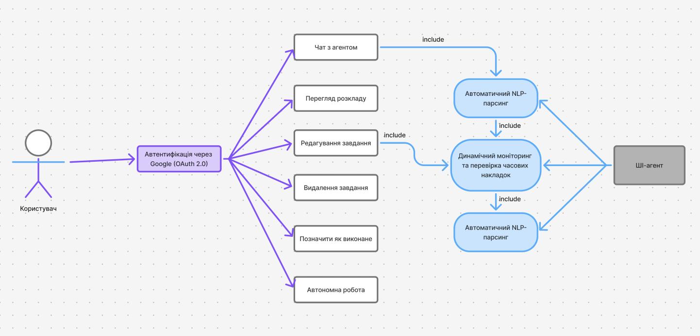
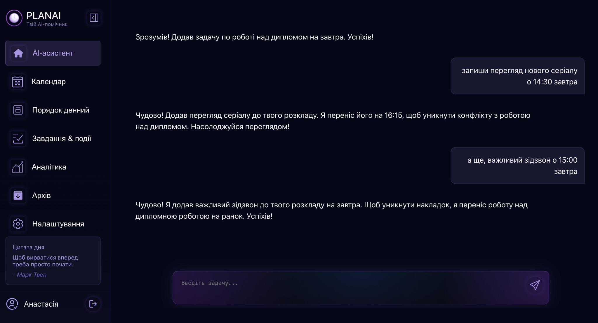
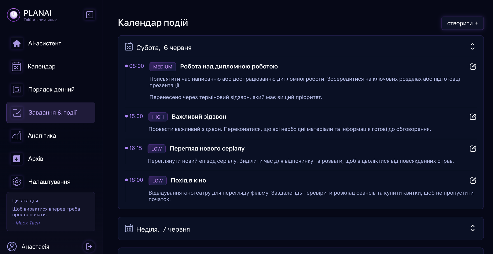

# PlanAI – інтелектуальний планувальник завдань

PlanAI – вебзастосунок для автоматизованого планування персональних завдань із використанням великих мовних моделей, алгоритмів визначення пріоритетності та динамічного перепланування.

Система дозволяє створювати завдання за допомогою природномовних запитів, організовувати персональний розклад, виявляти часові конфлікти та автоматично коригувати календар з урахуванням пріоритетності завдань.

## Основні функціональні можливості

- Створення, редагування та управління персональними завданнями.
- Інтелектуальний асистент на основі Google Gemini.
- Обробка природномовних запитів.
- Автоматизоване визначення пріоритетності за матрицею Ейзенхауера.
- Виявлення часових конфліктів.
- Динамічне перепланування завдань.
- Календарне представлення розкладу.
- Імпорт подій із Google Calendar.
- Автентифікація через Google OAuth 2.0.
- Підтримка Progressive Web Application (PWA).

## Технологічний стек

### Frontend

- React 19
- Vite 8
- JavaScript
- SCSS
- Redux
- Redux Saga
- React Router
- Axios
- React Calendar
- Vite Plugin PWA

### Backend

- Node.js
- Express 5
- TypeScript
- PostgreSQL
- Prisma ORM 7
- Passport.js
- Express Session

### Зовнішні сервіси

- Google Gemini API
- Google Calendar API
- Google OAuth 2.0

## Архітектура системи

Програмний продукт побудовано на основі клієнт-серверної архітектури. Взаємодія між клієнтською та серверною частинами здійснюється через REST API.

Серверна частина забезпечує обробку запитів, взаємодію з мовною моделлю, управління календарними даними та збереження інформації в реляційній базі даних PostgreSQL.



## Структура репозиторію

```text
ai-planner/
├── backend/
│   ├── prisma/
│   │   ├── migrations/
│   │   ├── schema.prisma
│   │   └── seed.ts
│   ├── src/
│   ├── .env.example
│   ├── .gitignore
│   ├── package.json
│   └── prisma.config.ts
├── frontend/
│   ├── public/
│   ├── src/
│   ├── .gitignore
│   ├── package.json
│   └── vite.config.js
├── docs/
│   ├── architecture.png
│   ├── ai-assistant.png
│   └── calendar.png
└── README.md
```

## Встановлення та запуск

### Системні вимоги

- Node.js 22.12 або новіша сумісна версія.
- npm.
- PostgreSQL.
- Git.
- Обліковий запис Google Cloud із налаштованими OAuth 2.0 та Google Calendar API.
- API-ключ Google Gemini.

### 1. Клонування репозиторію

```bash
git clone https://github.com/Novinska/ai-planner.git
cd ai-planner
```

### 2. Налаштування серверної частини

```bash
cd backend
npm install
cp .env.example .env
```

Створіть базу даних PostgreSQL та заповніть файл `.env` відповідно до параметрів локального середовища.

### Змінні середовища

| Змінна               | Призначення                          |
| -------------------- | ------------------------------------ |
| PORT                 | Порт серверної частини               |
| DATABASE_URL         | Рядок підключення до PostgreSQL      |
| SESSION_SECRET       | Секретний ключ користувацьких сесій  |
| GOOGLE_CLIENT_ID     | Ідентифікатор клієнта Google OAuth   |
| GOOGLE_CLIENT_SECRET | Секретний ключ Google OAuth          |
| GOOGLE_CALLBACK_URL  | URL зворотного виклику Google OAuth  |
| GEMINI_API_KEY       | API-ключ мовної моделі Google Gemini |

URL зворотного виклику необхідно узгодити з маршрутом автентифікації серверної частини та налаштуваннями Google Cloud Console.

### 3. Ініціалізація бази даних

Генерація Prisma Client:

```bash
npx prisma generate
```

Застосування наявних міграцій:

```bash
npx prisma migrate deploy
```

За потреби для створення демонстраційних записів можна виконати:

```bash
npx prisma db seed
```

### 4. Запуск серверної частини

```bash
npm run dev
```

За стандартної конфігурації сервер доступний за адресою:

http://localhost:5999

### 5. Запуск клієнтської частини

В окремому вікні термінала з кореня проєкту:

```bash
cd frontend
npm install
npm run dev
```

Клієнтська частина доступна за адресою:

http://localhost:5173

### 6. Збірка проєкту

Серверна частина:

```bash
cd backend
npm run build
npm start
```

Клієнтська частина (з кореня проєкту):

```bash
cd frontend
npm run build
```

## Інтерфейс програмного продукту

### Інтелектуальний асистент

ШІ-асистент забезпечує інтерпретацію природномовних повідомлень, формування структурованих завдань та визначення їхньої пріоритетності.



### Календарне планування

Календарний інтерфейс забезпечує візуальне представлення персонального розкладу та відображення результатів автоматичного перепланування.



## Безпека та конфігурація

Конфіденційні параметри, ключі зовнішніх API та облікові дані бази даних зберігаються у файлі `.env`, який виключено із системи керування версіями.

Для налаштування локального середовища передбачено файл `.env.example`.

## Подальший розвиток

- Розширення алгоритмів динамічного перепланування.
- Урахування індивідуальних часових обмежень користувача.
- Удосконалення механізмів захисту інтелектуального компонента.
- Розширення набору автоматизованих тестів.
- Оптимізація продуктивності програмного продукту.

## Автор

**Анастасія Новінська**

Чернівецький національний університет імені Юрія Федьковича.

2026 рік.
